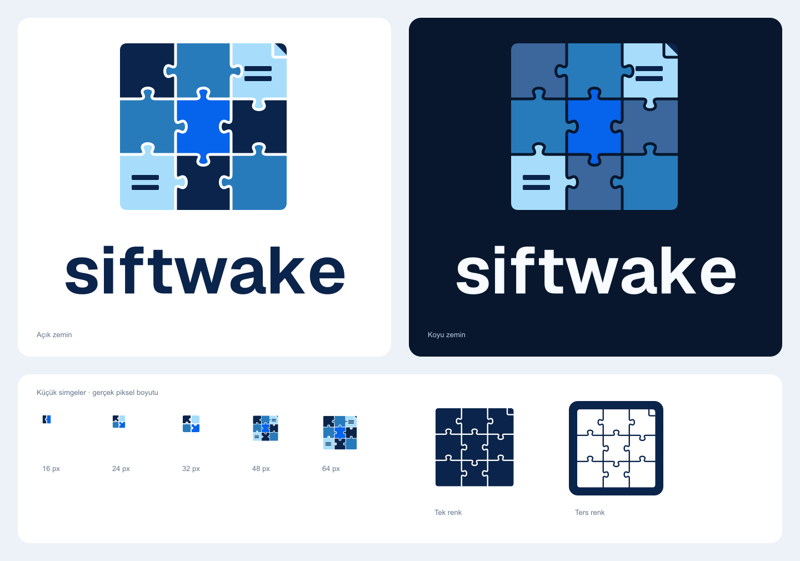
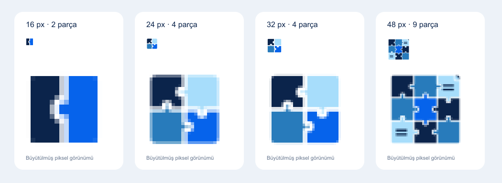

# Siftwake

Onaylanan dokuz puzzle belgeden oluşan simgenin vektör çizimi.

## Dosyalar

| Kullanım | Dosya |
| --- | --- |
| Açık zeminde yatay logo | `siftwake-logo.svg` |
| Koyu zeminde yatay logo | `siftwake-logo-dark.svg` |
| Açık zeminde dikey logo | `siftwake-logo-stacked.svg` |
| Koyu zeminde dikey logo | `siftwake-logo-stacked-dark.svg` |
| Renkli ana simge | `siftwake-mark.svg` |
| Koyu zeminde renkli simge | `siftwake-mark-dark.svg` |
| Tek renk lacivert / beyaz simge | `siftwake-mark-mono.svg`, `siftwake-mark-white.svg` |
| 24–32 px için dört parçalı simge | `siftwake-icon-small.svg`, `siftwake-icon-small-dark.svg` |
| 16 px için iki parçalı simge | `siftwake-icon-micro.svg`, `siftwake-icon-micro-dark.svg` |
| PNG simgeler | `siftwake-icon-{16,24,32,48,64,128,256,512}.png` |
| Küçük koyu zemin PNG simgeler | `siftwake-icon-{16,24,32}-dark.png` |
| Windows / favicon | `siftwake.ico`, 16/32/48/256 px |
| GitHub avatar | `siftwake-avatar.svg`, `siftwake-avatar.png`, 512×512 |
| GitHub social preview | `siftwake-social.svg`, `siftwake-social.png`, 1280×640 |

Yatay logoların 2160 px genişlikte, dikey logoların 1200 px genişlikte,
ana simgelerin 1024 px boyutta şeffaf PNG karşılıkları bulunur.
Önizleme tablosunun, avatarın ve sosyal paylaşım görselinin zemini opaktır.
Avatar dairesel kırpmaya uygun boşlukla hazırlanmıştır.

## Renk ve çizim

| Renk | HEX |
| --- | --- |
| Lacivert | `#0B244B` |
| Orta mavi | `#287BBB` |
| Buz mavisi | `#A7DDFB` |
| Merkez mavi | `#0663EB` |
| Koyu zemindeki açık lacivert | `#3B679C` |
| Önizleme koyu zemini | `#08172D` |
| Koyu zemin yazısı | `#F7FAFF` |

Seçilen taslaktaki dokuzlu düzen, merkezdeki mavi parça ve iki belgedeki
metin çizgileri korunarak geometrik yollarla yeniden çizildi. Puzzle
kenarları ortak eğrilerden üretildi. Parçalar arasındaki boşluklar alfa
maskesidir ve konduğu zemini gösterir. Renk geçişleri düz dolgulara
dönüştürüldü. Koyu zemin sürümünde lacivert parçalar aydınlatıldı.

Boyuta göre parça sayısı azaltıldı.

| Boyut | Parça | Çizim |
| --- | ---: | --- |
| 16 px | 2 | Bir büyük puzzle birleşimi, lacivert ve merkez mavisi |
| 24–32 px | 4 | 2×2 düzen, dört temel renk ve belirgin puzzle birleşimleri |
| 48 px ve üzeri | 9 | Ana simge, belge çizgileri ve kıvrık köşe |

Küçük sürümlerde metin çizgileri ve kıvrık köşe kaldırıldı, ayırıcı
boşluklar kalınlaştırıldı. Kare dış hat, renk paleti ve puzzle bağlantısı
ortak kimliği taşır. PNG ve ICO dosyaları kendi boyutuna uygun çizimden
üretildi. Koyu zemin için küçük SVG ve PNG karşılıkları da bulunur.

Yazı Geist, 650 ağırlık temel alınarak harf yollarına dönüştürüldü.
SVG logolar font kurulumu veya dış ağ kaynağı gerektirmez.
Geist lisansı `Geist-OFL.txt` dosyasında bulunur. SVG dosyalarında
görsel başlığı ve erişilebilir ad yer alır.

## Kontrol

SVG XML yapıları, PNG ölçüleri ve alfa kanalları doğrulandı. Açık/koyu
zemin, tek renk ve gerçek 16/24/32/48/64 px örnekleri görsel olarak
incelendi. ICO içinde dört PNG boyutu bulunur.
