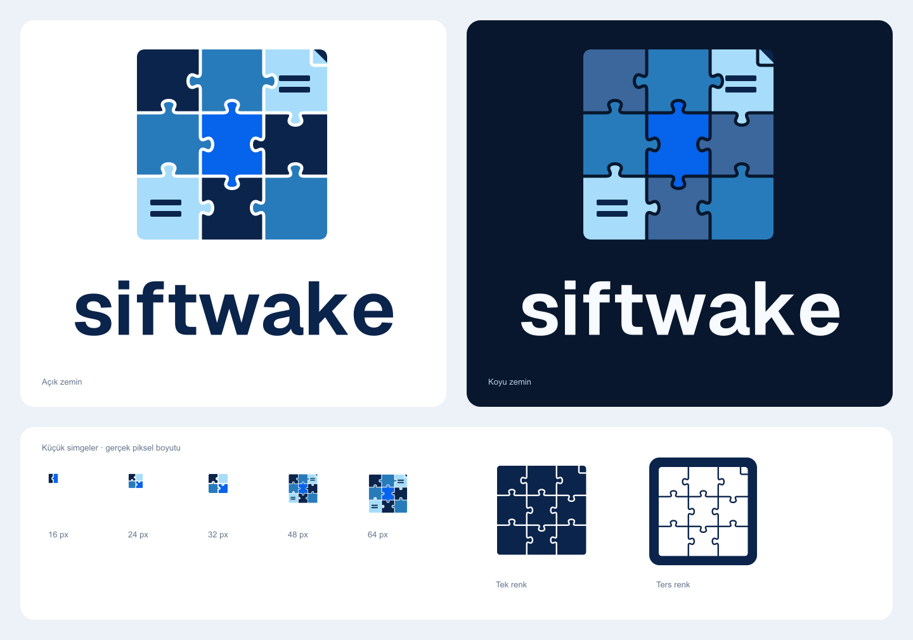
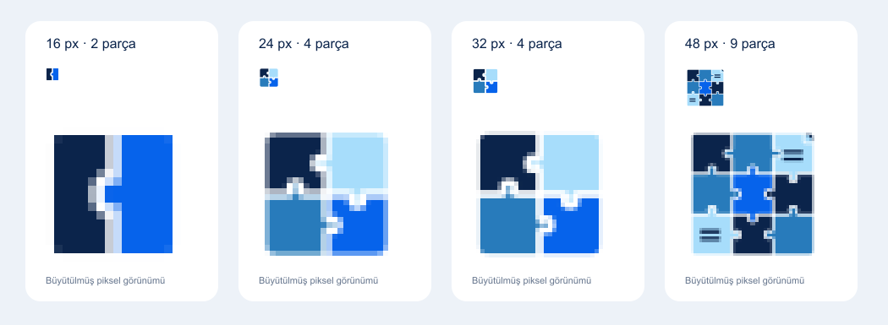

# Siftwake brand guide

**Document storage. Content search.**

Siftwake is an embedded document database and content search engine written in
Rust. Its identity centers on documents becoming a connected, searchable
collection.

## Name and language

Use **Siftwake** in prose and **siftwake** in the logo. The word combines the
idea of sifting through information with the trace left by changing documents.
The short description is “An embedded document database and content search
engine written in Rust.”

Public project documentation uses English. Historical reports retain their
original language. Use concrete descriptions of storage, search, updates and
measured behavior. Performance claims should name their corpus, settings and
source report.

## Symbol

The main symbol is a square of nine interlocking document pieces. The blue
central piece creates focus. Two document surfaces carry text lines, and a
folded corner reinforces the document shape.

| Display size | Symbol |
| --- | --- |
| 48 px and larger | Nine document pieces |
| 24–32 px | Four puzzle pieces |
| 16 px | Two puzzle pieces with one broad join |

Choose the version by final rendered size. The smaller symbols retain the
square silhouette, blue palette and interlocking construction.

## Color

| Color | HEX | Use |
| --- | --- | --- |
| Midnight navy | `#0B244B` | Primary wordmark and document pieces |
| Index blue | `#0663EB` | Central focus |
| Medium blue | `#287BBB` | Supporting pieces |
| Ice blue | `#A7DDFB` | Supporting documents |
| Dark-surface blue | `#3B679C` | Navy-piece replacement on dark backgrounds |
| Dark background | `#08172D` | Dark presentations |
| Paper | `#F7FAFF` | Wordmark on dark backgrounds |

Use solid fills. SVG seams are transparent and reveal the background. For
dark surfaces, use the dedicated dark files. Use the monochrome navy or white
mark when a single ink is required.

## Typography

The wordmark is outlined Geist at weight 650. Its files render independently
of installed fonts. Use Geist for surrounding identity materials when available
and a system sans-serif fallback for technical documents. Use a monospace face
for source code and commands.

Keep the wordmark as supplied so letter spacing and proportions remain
consistent. The Geist license is included with the asset pack.

## Layout

Use the horizontal logo in README headers, navigation and wide layouts.
Use the stacked logo in square or portrait presentations. Use the mark alone
for an avatar, favicon or app icon.

Reserve clear space around a logo equal to at least half one main puzzle cell.
In a circular avatar, use the padded avatar asset. Scale proportionally and
choose a flat background with enough contrast to reveal the separating seams.
For text on blue backgrounds, use the supplied white wordmark.

## Project materials

- [Vector and raster asset guide](../assets/brand/README.md)
- [GitHub avatar](../assets/brand/siftwake-avatar.png)
- [Social preview](../assets/brand/siftwake-social.png)
- [Horizontal logo](../assets/brand/siftwake-logo.svg)
- [Dark horizontal logo](../assets/brand/siftwake-logo-dark.svg)
- [Windows icon](../assets/brand/siftwake.ico)

The public preview version is `0.1.5-preview`. FDB names in engineering history
and storage-format identifiers identify the preceding development work.
[Version mapping](VERSIONING.md)
