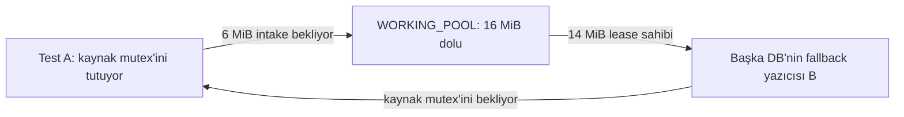

# Paralel test takılması — 29 Ekim 2026

**Teşhis edildi ve test kontrol mekanizması düzeltildi.** Sorun yalnız yavaş
test değildi: global kaynak kilidi ile proses çalışma bütçesi arasında yeniden
üretilebilen bir bekleme çevrimi vardı. Üretim bütçeleri/kilitleri değiştirilmedi.
C ABI bu çalışma kapsamında başlatılmadı.

## Hangi test, hangi kaynak?

`engine::profile::tests::bounded_trace_associates_old_and_new_publications_with_the_enclosing_commit`
ve `engine::light_flush::tests::frozen_prefix_tail_relocation_and_last_snapshot_wal_pin`,
arka plan işini durdurmak için **proses genelindeki** `maintenance_workspace()`
mutex'ini tutarken aynı testte `commit_streamed()` çağırıyordu. Başka DB'lerdeki
test worker'ları da bu mutex'i kullanır. Benzer global durdurmalar light,
revision ve snapshot testlerinde bulunuyordu.

Çevrim:

1. Test A kaynak mutex'ini tutar; henüz bırakmadan küçük commit çağırır.
2. Başka DB'nin streamed fallback yazıcısı B, 14 MiB çalışma lease'i almıştır;
   kaynağını yazmak için A'nın tuttuğu mutex'i bekler.
3. Pool'un 16 MiB sınırında 2 MiB sabit rezervasyon + B'nin 14 MiB'i vardır.
   A'nın 6 MiB intake isteği bekler. A commit dönmeden mutex'i bırakmaz.



`RUST_TEST_THREADS=1` bu **ayrı test DB'lerinin** çakışmasını kaldırdığı için
geçiyordu. Aynı DB'nin tek 8 MiB prefix worker'ı + 6 MiB intake + 2 MiB sabit
rezervasyonu ise sınıra sığar. İlk dar 8+6 tanı denemesi bu yüzden çevrimi
göstermedi; o tanıdaki hatalı assertion ve teardown takılması korunmuş
[ilk logdadır](benchmarks/posting-deadlock-20261029-v1-cycle-witness.log).
Tanı prosesi durduruldu; bu koşu GEÇTİ sayılmadı.

## Kontrollü yeniden üretim

İzole `global_source_pause_and_streamed_budget_cycle_witness` gerçek iki
Database kullanır. Tanı ana thread'i kaynak kilidini tutar; B fallback işinin
14 MiB'i aldığını gözler; A'nın küçük commit'ini ayrı thread'e koyar. Böylece
100 ms sonra kilidi bırakıp çevrimi çözebilir: kalıcı takılı proses bırakmadan
aynı beklemeyi ölçer. Kilit bırakıldıktan sonra iki commit ve oracle geçer.

```text
witness parent ThreadId(2) holds source workspace
witness writer ThreadId(4) requests streamed budget
budget wait ThreadId(4) used=16777216 minimum=6291456 limit=16777216
source-workspace request ThreadId(3)
witness cycle observed; parent releases source workspace
source-workspace acquired ThreadId(3)
```

[Başarılı yeniden üretim, thread kimlikleri ve ham iz](benchmarks/posting-deadlock-20261029-v2-cycle-witness.log).
Tanı testi global kaynakları özellikle tuttuğundan normal pakette ignored'dır;
ayrı `--ignored --exact --test-threads=1` komutuyla çalıştırıldı. Bu ignored
işareti bir kurtarma/ürün testini kapatmıyor, bu yeni tanının izole koşuludur.

## Çözüm ve ikinci yarış

`engine/test_jobs.rs` yalnız `cfg(test)` derlenir. Durdurma veritabanının
canonical dizinine özeldir. Normal merge, prefix flush ve revision worker'ı,
global çalışma bütçesi/kaynak kilidi almadan önce bu kapıya gelir. Testler hedef
worker'ın kapıya vardığını bekler; ilgisiz DB'nin kaynaklarını bloke etmez.
Üretim binary'sinde bu kapı ve çağrıları yoktur.

`local_worker_pause_does_not_block_another_database_streamed_builder`
regresyonu hedef worker durmuşken başka DB'nin gerçek fallback commit'inin
bitmesini doğrular. Assertion/join öncesi kapı bırakılır; hata yolunda da
worker'ın sahip olduğu DB'nin Drop/join'i kapının altında tutulmaz.

İlk düzeltilmiş paralel koşu bir **ikinci test yarışını** açığa çıkardı:
`cancelled_request_is_sticky_not_poisoned_and_cancels_admission`,
`Permits::acquire(4)` çağrısının dört iznin tamamını verdiğini varsayıyordu.
API en fazla o anda boş olan sayıyı verir. Diğer sorgular izinlerini sonradan
bırakınca iptal testindeki sorgu iptalden önce bitebiliyordu. [Başarısız koşu](benchmarks/posting-deadlock-20261029-v1-parallel-fixed.log)
korundu. Test artık verilen lease'leri sayıp dört iznin tamamını tutmadan
admission beklemesi iddia etmiyor. Ürün permit API'si değiştirilmedi.

## Doğrulama

| Koşu | Sonuç |
|---|---|
| Eski global durdurma çevrimi, izole iki DB | Yeniden üretildi; kilit bırakılınca iki commit tamamlandı |
| İlk paralel düzeltme | 145 geçti / 1 iptal-testi yarışı kaldı; gizlenmedi |
| 16 thread, iki test düzeltmesi | 148 geçti / 13 helper ignored |
| Diagnostic lib, 16 thread | 148 geçti / 13 helper ignored |
| İsteğe bağlı cache bütçesi son düzenlemesi sonrası 16 thread | 148 geçti / 13 helper ignored |
| Nihai `cargo test --all-targets`, varsayılan paralellik | 243 geçti; RUST_TEST_THREADS=1 kullanılmadı |

[16-thread tekrar](benchmarks/posting-deadlock-20261029-v2-parallel-fixed.log),
[diagnostic tekrar](benchmarks/posting-pages-20261029-v1-diagnostic-tests.log),
[nihai 16-thread tekrar](benchmarks/posting-deadlock-20261029-v3-parallel-fixed.log),
[nihai tam paket](benchmarks/snapshot-10k-20261026-validation-posting-pages-20261029-v2-test.log),
[fmt/clippy/features/SQLite kontrol sonuçları](benchmarks/snapshot-10k-20261026-validation-posting-pages-20261029-v2.json).

Bu bulgu üretimde rastgele iki normal DB'nin kilitlendiği iddiası değildir:
kanıtlanan çevrim, testin normal kilit sırasını ters çeviren global durdurma
mekanizmasına ihtiyaç duyuyor. Bunun çözülmesi C ABI çalışmasını başlatma onayı
değildir. 100k, yazma profili, uzun snapshot ve soğuk cache işleri kendi
kapılarında bekliyor; durum [OPEN-WORK](OPEN-WORK.md) içinde korunur.

Nihai ilerleyen cursor sonrası [tam paralel243 test](benchmarks/snapshot-10k-20261026-validation-posting-pages-20261029-v3-test.log) ve [16-thread diagnostic149 test](benchmarks/posting-pages-20261029-v3-diagnostic-tests.log) de geçti.
